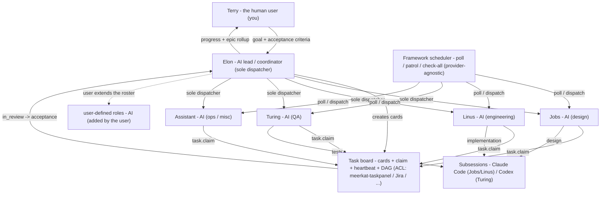

# openclaw-team

Install a small **AI agent dev team** onto an OpenClaw host: one coordinator (Elon)
plus four specialists (design / engineering / QA / assistant). Built for a
**standard individual independent developer** workflow.

> **English is the default documentation language.** See [README.zh-CN.md](README.zh-CN.md) for the Chinese mirror.

This repository is **Phase A (file-based, idempotent installer)**: `install.sh`
deploys protocol docs, per-agent workspaces (roles), skills, agent registration,
and config wiring onto OpenClaw. It is safe to re-run. **No plugin is involved**
(Phase B was explicitly dropped).

```text
You  ──►  Elon (main, coordinator)  ──►  Jobs (design) · Linus (dev) · Turing (QA) · Assistant (misc)
```

## Roles

| Role | agent id | workspace | Responsibility |
|---|---|---|---|
| 🧠 Elon | `main` | `workspace-elon` | Intake / carding / dispatch / acceptance / reporting |
| 🎨 Jobs | `jobs` | `workspace-jobs` | Product design / PRD / UI / UX |
| ⚙️ Linus | `linus` | `workspace-linus` | Implementation / fixes / refactoring · **CI gates / build / release / deploy** |
| 🧪 Turing | `turing` | `workspace-turing` | Testing / acceptance / regression / security audit |
| 🧹 Assistant | `assistant` | `workspace-assistant` | Video parsing / ops / misc |

> **Positioning & extending roles**: `openclaw-team` is a **framework for individual
> developers to quickly stand up a dev team**. It is built **around a software R&D
> team's scenario** — one coordinator plus four specialists — and is **not a
> general-purpose solution, nor one that suits every team**. These **five roles
> (elon / jobs / linus / turing / assistant) are the standard built-ins**; a
> non-R&D team should treat the framework as a **starting point** for building its own
> team, or **adjust the role duties** to fit. **Roles beyond the five** (e.g.
> business-specific positions) are **defined/extended by the user** — the framework
> does not hard-code any instance's extra roles.


## Team architecture

The team is **one human user plus five AI agents**. In the diagram below the top
layer — **Terry — is the human user (you)**, *not* an agent; **every layer below is
AI**.



**Layers**

1. **Terry — the human user (you).** Sets the goal and the acceptance criteria;
   receives progress and epic rollups; makes the few decisions only a human can make.
2. **Elon — AI lead / coordinator.** The **sole card creator and sole dispatcher**:
   breaks requirements into cards, dispatches, accepts, and reports.
3. **Jobs · Linus · Turing · Assistant — AI specialists.** Design / engineering /
   QA / ops.
4. **User-defined roles (AI).** Beyond the five built-ins, roles are **extended by
   the user** (see [Roles](#roles)).

The **task board**, **framework scheduler**, and **subsessions** in the diagram are
the plumbing detailed in [How the team collaborates](#how-the-team-collaborates) and
[Scheduling & team automations](#scheduling--team-automations).

## Roles, scope & SOP

**Scope** = what the role owns; **Not** = what it must *not* do. This is a summary —
the authoritative per-role SOP is each role's own file, and the boundary
reconciliation lives in `team/ROLES.md`.

| Role | Scope (owns) | Not (excluded) | Key outputs | Role SOP |
|---|---|---|---|---|
| 🧠 **Elon** (AI lead) | Intake · carding · dispatch · acceptance · reporting · team health; release & destructive-migration approval | Business code · design drafts · test execution | Task cards · dispatches · acceptance conclusions · reports | [`roles/elon/AGENTS.md`](roles/elon/AGENTS.md) |
| 🎨 **Jobs** (AI design) | Product design · PRD · UI · UX · image design · aesthetic ownership · UX/UI review · requirement/design baseline | Backend & business code · functional test execution | PRD · DESIGN · prototypes · images · issue list | [`roles/jobs/AGENTS.md`](roles/jobs/AGENTS.md) |
| ⚙️ **Linus** (AI engineering) | Code · fixes · refactor · build & self-test · CI gates · release/deploy | Product/UI design decisions · UX acceptance · functional acceptance | Code + tests · Report (with coverage) · CI/release evidence | [`roles/linus/AGENTS.md`](roles/linus/AGENTS.md) |
| 🧪 **Turing** (AI QA) | Functional testing · acceptance · regression · defect reproduction · security audit · requirement-conformance verification | Writing fixes/implementation · UI design | Test reports · defect tickets · traceability matrix | [`roles/turing/AGENTS.md`](roles/turing/AGENTS.md) |
| 🧹 **Assistant** (AI ops) | Video download & text parsing · ASR · subtitle OCR · marketing · operations · support · unbounded misc | Business code · UX design · functional testing | Video text/alignments · marketing/ops/support content | [`roles/assistant/AGENTS.md`](roles/assistant/AGENTS.md) |

Each role file holds that role's **standing orders (SOP)**. Cross-role rules are
**referenced, not copied**:

- **Routing / who gets what** — `team/PROTOCOL.md` **PROTOCOL §10 Task Triage Matrix**.
- **Boundaries & handoffs (reconciliation)** — `team/ROLES.md`.
- **Universal hard discipline (all roles)** — `team/PROTOCOL.md` **PROTOCOL §13 Universal Hard Discipline**.

## How the team collaborates

- **Task-card board.** Work lives on a **task-card board**, not in chat; a card
  carries Goal / Acceptance / Background and a state machine
  `backlog | todo → in_progress → in_review → done` (`blocked` / `canceled` are side
  and terminal states). The card is the single carrier of persisted content.
  `team/PROTOCOL.md` **PROTOCOL §1 Board Protocol**.
- **Claim · heartbeat · the three end-of-segment items.** A worker takes a card with
  an **atomic claim** (`task.claim`) and refreshes a **heartbeat every ≤10 min** while
  working. Every segment ends with **three closing items**: ① refresh the heartbeat →
  ② set the terminal state (`in_review` / `done` / `canceled` / `blocked`) → ③ send
  Elon a Report (conclusion + card path + commit hash). A fresh heartbeat on an
  `in_progress` card means "someone is already on it — do not re-run".
  `team/PROTOCOL.md` **PROTOCOL §1** and **PROTOCOL §13.2 The Three End-of-Segment Closing Items**.
- **Dependencies & parent/child (DAG).** A large job is one **`kind: epic`** parent —
  a container, **not claimable** — with **child cards** (`parent=<epic>`). Ordering
  uses **`depends_on`** (a child with unmet deps is not claimed). The epic reaches
  `done` only when **all its children are done and integration acceptance passes**
  (epic rollup). `team/PROTOCOL.md` **PROTOCOL §10.2 Composite Task = Subtask Cards + Dependency Graph (DAG)**.
- **One dispatcher: Elon.** **Elon alone creates cards and dispatches**; Jobs /
  Linus / Turing / Assistant **do not hand work to each other — they only request a
  card from Elon** (stating the need or the gap found). One owner per decision, one
  intake path. `team/PROTOCOL.md` **PROTOCOL §10** and **PROTOCOL §10.3 Carding Granularity**.
- **Defect loop.** A defect found in QA is written up as a defect ticket → **Elon
  creates a fix card** for Linus → the fix returns to Elon for acceptance → Turing
  runs a **regression retest**; the original card reaches `done` only when regression
  fully passes. `team/PROTOCOL.md` **PROTOCOL §9 Defect Fix and Regression Loop**.
- **Delivery gates.** Nothing is marked `done` before it passes its gates:
  engineering quality (TDD, coverage ≥80 %, integration tests, self-proof), UI
  fidelity (the prototype is the contract), documentation sync, and the
  **machine-checkable gates** run by CI / `check-all`. `team/PROTOCOL.md`
  **PROTOCOL §6.1 Engineering Quality Standards** and **PROTOCOL §20 Gates and Archiving**.
- **Parallelism first.** Workers run **in parallel by default**; only a
  **write-resource conflict** (same file, non-isolatable resource), an unmet
  `depends_on`, or an explicit "must serialize" serialises them. Elon's patrol pushes
  parallelism and chases stale cards. `team/PROTOCOL.md` **PROTOCOL §6.3 Worker Parallelism-First**.

The scheduler that wakes workers (`poll-<agent>`, `task-patrol`, `sla-scan`,
`team-check-all`, `skills-update`, `tmp-gc`) is described in
[Scheduling & team automations](#scheduling--team-automations).

## AI-Agent Collaboration Guide (for non-programmers)

You do **not** need to write code, run agents, or understand the internals. You
describe the outcome in plain language; the team turns it into work items, executes,
and reports back. The whole loop is four steps:

1. **You describe the requirement — goal + acceptance criteria.** Say what you want
   in one line *and* what "done" looks like (the acceptance criteria). The clearer
   the "done" line, the better the result.
2. **Elon breaks it into cards (an epic + child cards).** A large requirement becomes
   one **epic** with **child cards** (design / development / testing), ordered by
   dependency.
3. **Agents execute — design, development, testing.** Jobs designs, Linus builds (and
   runs CI/release), Turing verifies; a defect automatically goes back through the
   defect loop.
4. **You only watch the task status and the epic progress.** You do **not** follow
   subsessions or logs — you look at each card's state
   (`todo → in_progress → in_review → done`) and the epic rollup. Elon reports
   milestones to you and escalates only the decisions that need you.

### Best practices

- **Write the goal and "what done looks like".** A one-line goal plus explicit
  acceptance criteria is what makes the work checkable instead of guesswork.
- **Give direction, don't micromanage.** Hand over the objective and let the team
  decide *how*; step-by-step instructions slow it down.
- **Watch progress; confirm key decisions.** Follow card status / epic progress; only
  a few decisions come back to you — design disagreement, security & data safety,
  architecture direction — answer those and let the team handle the rest.
- **Reuse templates.** Reuse the requirement/acceptance template and existing card
  patterns; a consistent, complete brief is faster to intake and less likely to be
  sent back.

### Minimal example

| Step | What happens | What you see |
|---|---|---|
| **You** | "Add a dark-mode toggle to the settings page." | — |
| **Elon** | Creates the epic **Dark-mode toggle** + child cards *design toggle + mockup* → *implement theme switch* → *verify all pages* (with `depends_on`) | cards appear as `todo` |
| **Agents** | Jobs designs → Linus builds (CI green) → Turing verifies | cards move `in_progress → in_review` |
| **You** | Watch status; answer any escalated decision | cards turn `done`; the epic rolls up; Elon reports "complete" |

## Install

```bash
git clone <this-repo> <path/to/openclaw-team>   # example path — clone anywhere
cd <path/to/openclaw-team>
./install.sh --dry-run      # preview every action
./install.sh                # idempotent install
```

Options:

| Option | Meaning |
|---|---|
| `--dry-run` | Print planned actions, change nothing |
| `--force` | Overwrite existing skills / role files / team docs |
| `--openclaw-home DIR` | OpenClaw home (default `~/.openclaw`) |
| `--claude-home DIR` / `--codex-home DIR` | Claude Code / Codex home |
| `--meerkat-taskpanel DIR` | Path to the meerkat-taskpanel source checkout |
| `--with-meerkat-taskpanel` | Install the reference task provider (**meerkat-taskpanel is installed by default**) |
| `--no-meerkat-taskpanel` | Opt out of meerkat-taskpanel; bring your own task system (Jira / Plane / Linear / …) via the `task-interface` ACL |
| `--skip-automations` | Do not register the team-level scheduled jobs |
| `--prototype <carrier>` | Prototype carrier: `static-html` \| `figma` \| `google-stitch` \| `pixso` (default `static-html`); recorded in `~/.openclaw/team/team.config.json` for Jobs/Linus |
| `--keys` / `--skip-keys` | Force / skip the interactive API-key prompt (default: prompt only on a TTY) |
| `--keep-existing` | Never overwrite existing files (skip instead of upgrade) |
| `--skip-skills` `--skip-agents` `--skip-config` `--skip-team` | Skip a stage |
| `--skip-skill-clis` | Do not install/probe the external CLIs the declared skills need (alias `--skip-ocr-cli`) |
| `--vendor` | Snapshot skills from their sources into `skills/vendor/` |
| `--offline` | Install skills from `skills/vendor/` (no network) |

`legacy-name-compat`: the pre-rebrand flag names `--task-panel` / `--with-task-panel` / `--no-task-panel`
are still accepted as deprecated aliases (each prints a one-line note), so existing callers and scripts
keep working unchanged.

What the installer does (every stage is idempotent; existing items are skipped):

1. **Preflight** — node / OpenClaw CLI; checks for `claude` and `codex` (warns with
   install hints if absent; never aborts).
2. **Team docs** → `~/.openclaw/team/` (`PROTOCOL.md`, `ROLES.md`, `README.md`,
   `guides/`). Never touches runtime dirs `tasks/`, `workspace/`, `memory/`.
3. **Skills (declared sources)** — resolves every entry in `skills/manifest.json`
   from its upstream (ClawHub / GitHub / git) and installs it into the right
   target. Entries with no verified upstream (`needs_source`) are skipped with a
   warning. `--vendor` snapshots sources into `skills/vendor/`; `--offline`
   installs from that snapshot.
4. **Agents & role workspaces** — copies `AGENTS.md`/`SOUL.md`/`IDENTITY.md`, then
   `openclaw agents add <id> --workspace <dir> --non-interactive` (skipped if the
   agent already exists). An existing `USER.md` is **never** overwritten.
5. **Config fragments** → `openclaw config patch --file config/*.json5`
   (anything under `config/examples/` is reference-only and not applied).
6. **Task provider (ACL)** — reports the configured provider
   (`OPENCLAW_TEAM_TASK_PROVIDER`, default `meerkat-taskpanel`) and installs the
   reference provider **meerkat-taskpanel by default**. `--no-meerkat-taskpanel` opts out and
   prints how to bring your own (Jira / Plane / Linear / … via the `task-interface`
   ACL).
7. **Team automations (scheduling)** — registers the team-level scheduled jobs
   (`poll-<agent>` every 5m, `task-patrol` every 15m, `sla-scan` every 15m,
   `team-check-all` hourly, `skills-update` weekly, `tmp-gc` daily 02:20),
   **declaratively** (by `declarationKey`; `config/reconcile.mjs` emits add/edit/skip
   so re-runs self-heal drift) and **provider-agnostically**: each trigger calls the
   framework dispatcher `team/automations/dispatch.mjs`, never a provider literal.
   `--skip-automations` disables it. See
   [Scheduling & team automations](#scheduling--team-automations).
8. **Config optimization (providers backfill)** — backfills missing provider
   optimization fields into `~/.openclaw/openclaw.json` (merge, never a whole-file
   overwrite): `contextTokens: 200000` on models whose declared `contextWindow` exceeds
   the threshold (default 200000), `cost.cacheRead` for the
   whitelisted deepseek ids, `agents.defaults.compaction/contextPruning/contextLimits`.
   Existing values are never overwritten; disable with
   `OPENCLAW_TEAM_OPTIMIZE_PROVIDERS=0` (see
   [Config optimization & cron slimming](#config-optimization--cron-slimming)).

### Upgrade / reinstall

The default mode is **install-or-upgrade**. Re-running `./install.sh` after a repo
update overwrites previously installed managed content:

- **Managed** (updated on upgrade): team docs, role seeds `AGENTS.md` / `SOUL.md` /
  `IDENTITY.md`, config fragments, and skills.
- **User-owned** (never touched): `USER.md`, `team/tasks/`, `team/workspace/`,
  `team/memory/`, and the session registries.
- **Backup**: any managed file that differs is copied to
  `~/.openclaw/team/.backups/<timestamp>/` **before** being overwritten.
- **State**: the installed version is recorded in
  `~/.openclaw/team/.install-state.json`; upgrades print the old → new version.
- **Opt out**: `--keep-existing` restores the old install-only behaviour (skip
  existing files).

```bash
./install.sh --dry-run        # preview install/upgrade actions
./install.sh                  # install or upgrade managed content
./install.sh --keep-existing  # never overwrite
```

### Skills (option A: declarations, not vendored code)

Skill **bodies are not stored in this repo**. `skills/manifest.json` declares each
skill's upstream source; `skills/lock.json` pins resolved refs and tree hashes.
The installer fetches from source:

```bash
./install.sh                 # fetch + install from declared sources
./install.sh --vendor        # snapshot sources into skills/vendor/
./install.sh --offline       # install from a previous snapshot (no network)
node skills/update.mjs       # detect upstream ref drift — READ-ONLY, prints a change list
node skills/update.mjs --apply   # advance refs + rewrite lock + reinstall (reviewed step)
```

`skills/update.mjs` is the update path: it resolves each `kind:"github"` entry's current
upstream commit with `git ls-remote` and compares it to the pinned `source.ref`. Without
`--apply` it writes nothing and prints nothing when there is no drift; the weekly
`skills-update` job runs it in that mode (see [`skills/README.md`](skills/README.md) and
[`team/AUTOMATIONS.md`](team/AUTOMATIONS.md) §1).

Targets:

| Target | Where |
|---|---|
| `openclaw` | `~/.openclaw/skills/` |
| `claude` | `~/.claude/skills/` |
| `codex` | `~/.codex/skills/` |
| `agent:<id>` | `~/.openclaw/workspace-<id>/skills/` |

Some skills shell out to an external CLI instead of shipping one. Those CLIs are
declared in [`config/skill-clis.json`](config/skill-clis.json) with an explicit mode,
and the installer probes each one:

- **`mode: install`** — installed best-effort when missing: `ocr` for the
  `open-code-review*` skills, `gitnexus` for the `gitnexus-*` suite.
- **`mode: check-only`** — probed and reported, **never installed**: `tvly` for the
  `tavily-*` skills. Its upstream installer is a `curl | bash` pipe, and `tvly init`
  would overwrite the ref-pinned skill bodies `fetch.mjs` installs (use
  `tvly init --skip-skills` to authenticate without clobbering them).

Installing needs network and a global npm prefix, so the step is skipped on
`--dry-run` / `--vendor` / `--offline` and disabled by `--skip-skill-clis`; an install
that fails only warns. The closing summary reports every CLI's status and the exact
install command. Registering an **MCP server** is a separate, host-local step —
connectors are user-supplied (see
[`config/examples/mcp.example.json5`](config/examples/mcp.example.json5)): `gitnexus`'s
CLI is installed here, its MCP server entry is not, and without it the roles fall back
to grep.

Entries marked `needs_source: true` have no verified upstream yet and are skipped
until resolved. Provenance notes: [`skills/PROVENANCE.md`](skills/PROVENANCE.md).

> **Migrated (option A complete)**: third-party skill bodies are no longer
> vendored. All 90 declared skills resolve to verified upstreams (GitHub / ClawHub)
> and are fetched at install time via `skills/fetch.mjs`.

## Task system & scheduling (pluggable, via ACL)

**Ownership boundary**: `openclaw-team` owns the **scheduling** and the **ACL
abstraction**; the task base (meerkat-taskpanel / Jira / Plane / …) is only a **callee**
behind the ACL. The full contract is `team/guides/task-interface.md` (cards, atomic
claim + heartbeat, the `todo → in_progress → in_review → done | canceled` state
machine, comments/process trail, and a parent/child + dependency DAG); this README
does not restate it.

- **Default provider — meerkat-taskpanel**: installed by default (task skill + `taskctl`
  CLI). Opt out with `./install.sh --no-meerkat-taskpanel`; supply a source checkout with
  `--meerkat-taskpanel DIR`.
- **Bring your own / swap the base** — Jira, Linear, Plane, GitHub Issues, a custom
  board, …: install that system's connector skill/MCP and point the team at it with
  `OPENCLAW_TEAM_TASK_PROVIDER=<name>`. The upper layers (roles / SOP / jobs) change
  **zero** because they depend only on the ACL; then run the ACL contract tests
  (`task-interface.md §6`, `§12`).
- **Out of scope** — connector skills/MCP for third-party task systems are not part
  of this project; the repo ships only the ACL and the team-side adaptation contract.
- **Idempotent card creation** — creating cards is **idempotent**: before creating,
  the creator (LLM) **semantically de-duplicates** against existing non-terminal
  cards, backed by a mechanical key `idem = <kind>|<assignee>|<source>|<target>`;
  a same-key non-terminal card ⇒ **reject/reuse** (the repo bundles no create path,
  so the convention is **guaranteed by the connected provider** + the creator
  carrying the `idem` key). See `team/PROTOCOL.md PROTOCOL §29` and
  `team/guides/task-interface.md §14`.

### Scheduling & team automations

Team-level **scheduling is framework-owned and provider-agnostic** — it is *not*
delegated to the task provider. `install.sh` registers the jobs below
(idempotently, by `declarationKey`; `--skip-automations` disables them):

| Job | Schedule | Purpose |
|---|---|---|
| `poll-<agent>` | every 5m | per-worker board poll (jobs/linus/turing/assistant); fires only when a card is claimed |
| `task-patrol` | every 15m | stale `in_progress` heartbeat scan |
| `sla-scan` | every 15m (`OPENCLAW_TEAM_SLA_INTERVAL`) | board SLA inspection of the `PROTOCOL §15` waits `task-patrol` does not cover; fires only on a tier crossing (`team/guides/sla-inspection-contract.md`, `team/AUTOMATIONS.md §3.8`) |
| `team-check-all` | hourly (`0 * * * *` @ Asia/Shanghai) | gate patrol; fires only on failure |
| `skills-update` | Sundays 05:00 (Asia/Shanghai) | upstream skill-ref drift detect; fires only on drift/failure |
| `tmp-gc` | daily 02:20 (Asia/Shanghai) | scratch GC (`PROTOCOL §13.9`): deletes files >14 days old under `workspace-*/.tmp/`, `~/.openclaw/tmp/` and `~/.openclaw/team/tmp/`; fires only when the sweep could not be confirmed (`team/AUTOMATIONS.md §3.9`) |

Each trigger calls the framework dispatcher
`team/automations/dispatch.mjs <poll|patrol|check-all|skills-update|sla-scan|tmp-gc> [agent]`, which resolves the
provider's entry command (`team/automations/providers.json`; provider =
`OPENCLAW_TEAM_TASK_PROVIDER`, default `meerkat-taskpanel`) and returns `{"fire":…}`. **The
entry scripts themselves ship with this repository** — `poll.mjs`, `patrol-scan.mjs`,
`check-all.sh` and their dependency closure live in `team/scripts/**` and are
installed into `{team}/scripts/**`, so a fresh install has no dangling entry path.
No trigger script contains a provider literal, so **swapping the base changes zero
jobs**. A missing entry / failure / timeout / unparseable output ⇒ `fire:false`
(zero cost). Trigger evaluation is bounded (`OPENCLAW_TEAM_EVAL_TIMEOUT_MS`, default
8000 ms); the `already-running` run lock and stale-run release are platform
(Gateway scheduler) concerns the framework does not claim to solve.
Details and ACL gaps: `team/automations/README.md`, `team/AUTOMATIONS.md §3.5`.

### Config optimization & cron slimming

`install.sh` has two opt-out, idempotent hardening stages (both merge/patch —
`~/.openclaw/openclaw.json` is **never** whole-file replaced):

| Stage | What it does | Opt out |
|---|---|---|
| **Providers backfill** (`config/optimization.mjs`) | Fills **missing** `models.providers` optimization fields: `contextTokens: 200000` on models with `contextWindow` above the threshold (default 200000), `cost.cacheRead` on whitelisted deepseek ids (`deepseek-flash`→`0.006`, `deepseek-v4-pro`→`0.003625`), and the static `agents.defaults` compaction/contextPruning/contextLimits fragment. Existing values are **never** overwritten; the whole `models.providers` array is read-modify-written (a sparse patch would replace arrays). | `OPENCLAW_TEAM_OPTIMIZE_PROVIDERS=0` |
| **Cron slimming** (`config/reconcile.mjs`) | Declared jobs are the single source of truth; on every run the runtime is aligned (missing ⇒ add, drifted ⇒ edit, matching ⇒ skip). Poll interval thinned **1m → 2m → 5m** (`OPENCLAW_TEAM_POLL_INTERVAL`, default `5m`) and every job gets `--light-context`. Cron jobs (`team-check-all`) are **never** given `--every` — only `lightContext` is reconciled. | `--skip-automations` |

Providers-backfill tuning (mirrors `config/examples/model.example.json5`):

- `OPENCLAW_TEAM_CONTEXT_TOKENS` — the backfilled `contextTokens` value **and** the window
  threshold (default `200000`; a missing/non-positive/non-numeric value falls back to the
  default). Only models whose declared `contextWindow` is **strictly greater** are
  backfilled; unknown/≤-threshold windows are skipped.
- `OPENCLAW_TEAM_CONTEXT_TOKENS_ALL=1` — wildcard: ignore the window check and backfill
  `contextTokens` on **every** model missing it.

Markers & safety: the backfill stage records `optimizationApplied` in
`~/.openclaw/team/.install-state.json` (read-modify-write) and skips on re-run unless
`--force`; before patching it backs up the config and validates the patched result,
rolling back on failure. Roll back the whole stage by restoring the
`openclaw.json.pre-*` backup, then re-running with `OPENCLAW_TEAM_OPTIMIZE_PROVIDERS=0`.
Decisions: `team/AUTOMATIONS.md §4`.

### Extending roles

The five built-in roles (elon / jobs / linus / turing / assistant) are the standard
set; **roles beyond the five are defined by the user** — the framework does not
hard-code an instance's extra roles (see [Roles](#roles)). Adding one means adding
its workspace seed files and (optionally) a `poll-<agent>` automation; scheduling
itself stays the framework's job.

## Repository layout

```text
openclaw-team/
├─ install.sh                # idempotent installer entry point
├─ config/                   # auto-applied config patches (*.json5)
│  └─ examples/              # reference only (model / bindings / automations / project-metadata)
├─ roles/<agent>/            # workspace seeds: AGENTS/SOUL/IDENTITY/USER.md
├─ skills/
│  ├─ openclaw/              # global OpenClaw skills
│  ├─ claude/ codex/         # Claude Code / Codex skills
│  ├─ agents/<agent>/        # per-agent workspace skills
│  └─ PROVENANCE.md          # source + license manifest
└─ team/                     # static docs deployed to ~/.openclaw/team/
   ├─ PROTOCOL.md ROLES.md README.md AUTOMATIONS.md
   ├─ automations/           # framework dispatcher + provider entries (scheduling)
   ├─ scripts/               # framework entry scripts (poll/patrol/check-all) + tests
   └─ guides/
```

## Design principles

- **Static content only**: protocol, skills, role seeds, config fragments, installer.
  **Runtime state** (`team/tasks/`, `team/workspace/`, session registries) stays on
  the host and is never committed.
- **Idempotent**: re-runnable; existing files are preserved unless `--force`.
- **No secrets**: no tokens, credentials, or absolute personal paths in the repo.
- **Local first**: verify locally, then decide where to push.

## Out of scope

- Plugins / native extensions (Phase B).
- Runtime task cards and workspace artifacts.

## Verify (Docker)

Verification runs **inside Docker, never on the host**:

```bash
docker/verify.sh          # build image + run the offline suite
docker/verify.sh --net    # also exercise the upstream fetch path
docker compose -f docker/docker-compose.yml up --build --abort-on-container-exit
```

`docker/verify-in-container.sh` is the single source of truth (CI runs the same
script), so a green local run and a green CI run mean the same thing. It covers
shell/node syntax, manifest+lock integrity, installer/fetcher dry-runs, a real
file deploy into a throwaway HOME, and the install→upgrade→backup path.

**What it does *not* cover:** the framework test suite (`team/scripts/tests/*.test.mjs`)
lives in `check-all.sh`'s *slow* segment, which this script — and therefore CI — never
invokes. A green CI run says nothing about that suite.

For **UI fidelity** there is a second, network-based image that pins the browser
and fonts so pixel diffs are deterministic:

```bash
docker/ui-fidelity/verify.sh    # build + run the ui-fidelity self-test
```

See `tools/ui-fidelity/README.md` (L1 structural · L2 pixel regression · L3
prototype-as-oracle) and `team/guides/ui-align-sop.md` §10.

### Prototype carrier

The UI prototype's source is a **deployment choice** (`install.sh --prototype`),
recorded in `~/.openclaw/team/team.config.json` and consumed by both Jobs
(produces the baseline) and Linus (implements against it):

| Carrier | Baseline source | Required connector |
|---|---|---|
| `static-html` (default) | HTML/CSS/JS under `prototype/**` (closed stack: Tailwind + daisyUI + jQuery) | none |
| `figma` | Figma via MCP/API, or the exported static HTML mirror | MCP server **`figma`** |
| `google-stitch` | Stitch export bundle (static HTML + tokens + assets) | MCP/skill **`stitch`** |
| `pixso` | Pixso via MCP, or the exported file | MCP server **`pixso`** |

The installer **checks** the connector for non-`static-html` carriers and warns when it
is missing (declared in `config/prototype-carriers.json`; template in
`config/examples/mcp.example.json5`). Connectors are user-supplied.

See `roles/linus/AGENTS.md` "Prototype Consumption" and `roles/jobs/AGENTS.md`
carrier routing.

### API keys

Keys the install may need are declared in `config/api-keys.json` — the model
provider key, the memory-search key, `TAVILY_API_KEY` (used by the `tavily-*`
skills; keyless access has limits), and carrier tokens for
`figma`/`pixso`/`google-stitch`. When interactive the installer **prompts for each
one with hidden input**, and you may press **Enter to skip**; provided values are
stored `0600` in `~/.openclaw/team/.secrets.env` (never in the repo, never echoed).
At the end it prints a **unified key summary**: the status of every key plus the
exact command to set each one later. Non-interactive runs never prompt — they just
print the summary. Re-enter keys any time with `./install.sh --keys`.

## License

MIT — see [LICENSE](LICENSE).
