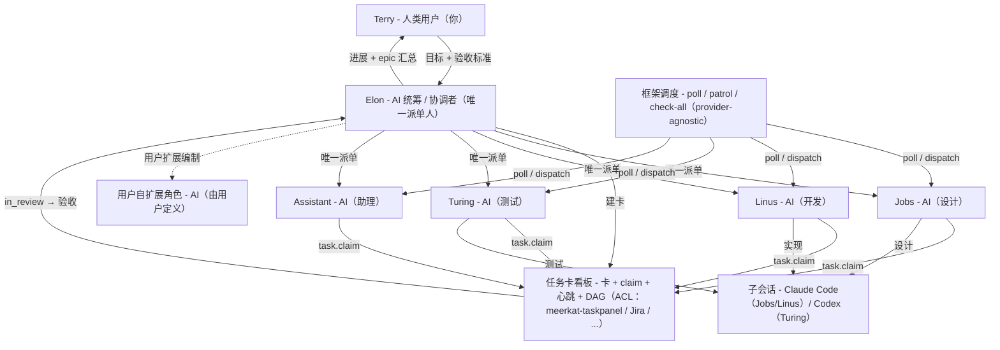

# openclaw-team

把一支 **AI Agent 研发团队** 装进一台 OpenClaw 主机：一名统筹（Elon）＋四名专家（设计 / 开发 / 测试 / 助理）。定位是**标准个人独立开发者**的多 agent 工作流。

> 本文是 [README.md](README.md) 的中文镜像；**英文为默认文档语言**。

本仓库是 **Phase A（纯文件 + 幂等安装器）**：`install.sh` 把协议、角色工作区、技能、agent 注册与配置装配到 OpenClaw，可重复执行。**不含插件**（Phase B 已明确不做）。

```text
你  ──►  Elon(main，统筹)  ──►  Jobs(设计) · Linus(开发) · Turing(测试) · Assistant(杂务)
```

## 角色

| 角色 | agent id | 工作区 | 职责 |
|---|---|---|---|
| 🧠 Elon | `main` | `workspace-elon` | 需求入口 / 建卡 / 派单 / 验收 / 汇报 |
| 🎨 Jobs | `jobs` | `workspace-jobs` | 产品设计 / PRD / UI / UX |
| ⚙️ Linus | `linus` | `workspace-linus` | 代码开发 / 缺陷修复 / 重构 · **CI 门禁 / 构建 / 发版 / 部署** |
| 🧪 Turing | `turing` | `workspace-turing` | 测试 / 验收 / 回归 / 安全审计 |
| 🧹 Assistant | `assistant` | `workspace-assistant` | 视频解析 / 运营 / 杂活 |

> **定位与角色扩展**：`openclaw-team` 是**面向个人开发者快速搭建研发团队的框架**。它**围绕软件研发团队场景**构建 —— 一名统筹 + 四名专家 —— **并非通用方案，也不适用于所有团队**。上表**五个角色（elon / jobs / linus / turing / assistant）是标准内置角色**；非研发团队应把它当作搭建自家团队的**起点**，或**据此调整角色职责**。**五角色之外的岗位**（如业务特有职位）由**用户自行定义/扩展**——框架不把任何实例的额外角色写死。


## 团队架构

团队 = **一个人类用户 + 五个 AI agent**。下图中**最上层 Terry 是「人类用户（你）」，不是 agent**；**其下每一层都是 AI**。



**层级说明**

1. **Terry —— 人类用户（你）**：给出目标与验收标准；接收进展与 epic 汇总；只做少数非人不可的决策。
2. **Elon —— AI 统筹 / 协调者**：**唯一建卡人 + 唯一派单人** —— 拆卡、派单、验收、汇报。
3. **Jobs · Linus · Turing · Assistant —— AI 专家**：设计 / 开发 / 测试 / 助理。
4. **用户自扩展角色（AI）**：五个内置角色之外，岗位由**用户自行扩展**（见 [角色](#角色)）。

图中的**任务卡看板**、**框架调度**与**子会话**，其机制见 [团队协作方式](#团队协作方式) 与 [调度与团队定时任务](#调度与团队定时任务)。

## 角色职责与 SOP

**职责范围** = 该角色负责的事项；**不做** = 明确排除的事项。下表为摘要 —— 各角色的权威 SOP 在各自角色文件里，边界对账见 `team/ROLES.md`。

| 角色 | 职责范围 | 不做 | 关键产出 | 角色 SOP |
|---|---|---|---|---|
| 🧠 **Elon**（AI 统筹） | 需求入口 · 建卡 · 派单 · 验收 · 汇报 · 团队健康；发布与破坏性迁移审批 | 业务代码 · 设计稿 · 测试执行 | 任务卡 · 派单 · 验收结论 · 汇报 | [`roles/elon/AGENTS.md`](roles/elon/AGENTS.md) |
| 🎨 **Jobs**（AI 设计） | 产品设计 · PRD · UI · UX · 图像设计 · 美学把关 · UX/UI 评审 · 需求/设计基线 | 后端与业务代码 · 功能测试执行 | PRD · DESIGN · 原型 · 图像 · 问题清单 | [`roles/jobs/AGENTS.md`](roles/jobs/AGENTS.md) |
| ⚙️ **Linus**（AI 开发） | 代码开发 · 缺陷修复 · 重构 · 构建与自测 · CI 门禁 · 构建/发版/部署 | 产品/UI 设计决策 · UX 验收 · 功能验收与回归 | 代码 + 测试 · Report（含覆盖率）· CI/发版证据 | [`roles/linus/AGENTS.md`](roles/linus/AGENTS.md) |
| 🧪 **Turing**（AI 测试） | 功能测试 · 验收 · 回归 · 缺陷复现 · 安全审计 · 需求符合性核验 | 写修复/实现 · UI 设计 | 测试报告 · 缺陷单 · 需求→实现追溯矩阵 | [`roles/turing/AGENTS.md`](roles/turing/AGENTS.md) |
| 🧹 **Assistant**（AI 助理） | 视频下载与文本解析 · ASR · 字幕 OCR · 运营 · 市场 · 客服 · 无明确边界的杂活 | 业务代码 · UX 设计 · 功能测试 | 视频文本/对齐 · 市场·运营·客服内容 | [`roles/assistant/AGENTS.md`](roles/assistant/AGENTS.md) |

各角色文件内含该角色**标准作业指令（SOP）**。跨角色规则**只引用、不复制正文**：

- **分流 / 什么活派给谁** —— `team/PROTOCOL.md` **PROTOCOL §10 任务分流矩阵**。
- **边界与交接（对账）** —— `team/ROLES.md`。
- **全员硬纪律** —— `team/PROTOCOL.md` **PROTOCOL §13 通用硬纪律**。

## 团队协作方式

- **任务卡看板**：工作活在**任务卡看板**上，而非聊天里；一张卡承载 Goal / Acceptance / Background，并走状态机 `backlog | todo → in_progress → in_review → done`（`blocked` / `canceled` 为旁路与终态）。卡是持久化内容的唯一载体。`team/PROTOCOL.md` **PROTOCOL §1 看板协议**。
- **claim · 心跳 · 段收尾三件**：worker 以**原子领取**（`task.claim`）接卡，执行期间**每 ≤10min 刷新心跳**。每个段结束都要做**三件收尾**：① 刷新心跳 → ② 落终态（`in_review` / `done` / `canceled` / `blocked`）→ ③ 给 Elon 发 Report（结论 + 卡路径 + commit hash）。`in_progress` 且心跳新鲜 = "已有人在跑，勿重复执行"。`team/PROTOCOL.md` **PROTOCOL §1** 与 **PROTOCOL §13.2 段收尾三件**。
- **依赖与父子（DAG）**：一大块需求 = 一张 **`kind: epic`** 父卡（容器，**不可领取**）+ 若干**子卡**（`parent=<epic>`）。先后关系用 **`depends_on`** 表达（依赖未满足的子卡不被领取）。父卡只有在**所有子卡完成且集成验收通过**后才 `done`（epic rollup 汇总）。`team/PROTOCOL.md` **PROTOCOL §10.2 复合任务 = 子任务卡 + 依赖图（DAG）**。
- **唯一派单人 Elon**：**建卡与派单只有 Elon**；Jobs / Linus / Turing / Assistant **互不派单 —— 只向 Elon 提要求**（说明需求或发现的缺口）。决策单一 owner、入口单一通路。`team/PROTOCOL.md` **PROTOCOL §10** 与 **PROTOCOL §10.3 建卡粒度**。
- **缺陷回环**：QA 发现的缺陷写成缺陷单 → **Elon 建修复卡**派给 Linus → 修复回到 Elon 验收 → Turing 做**回归复测**；回归完全通过，原卡才 `done`。`team/PROTOCOL.md` **PROTOCOL §9 缺陷修复与回归回环**。
- **交付门禁**：任何东西被标 `done` 前必须过门禁：工程质量（TDD、覆盖率 ≥80%、集成测试、自证）、UI 保真（原型即契约）、文档同步，以及 CI / `check-all` 跑的**机器可检门禁**。`team/PROTOCOL.md` **PROTOCOL §6.1 工程质量标准** 与 **PROTOCOL §20 门禁与归档**。
- **并行优先**：worker **默认并行**；只有**写资源冲突**（同文件、不可隔离资源）、`depends_on` 未满足、或卡上明确「必须串行」时才串行。Elon 的巡检会推动并行、追陈旧卡。`team/PROTOCOL.md` **PROTOCOL §6.3 worker 并行优先**。

唤醒 worker 的调度（`poll-<agent>`、`task-patrol`、`sla-scan`、`team-check-all`、`skills-update`、`tmp-gc`）见 [调度与团队定时任务](#调度与团队定时任务)。

## AI Agents 协作实践指南（面向非程序员）

你**不需要**写代码、跑 agent，也不需要懂内部细节。你只用大白话说清要什么；团队把它变成工作项、执行、再回报。整个循环就四步：

1. **你描述需求 —— 目标 + 验收标准。** 用一句话说清你要什么，**并且**说清"完成长什么样"（验收标准）。"完成"这条线越清楚，结果越好。
2. **Elon 拆卡（epic + 子卡）。** 一个大需求变成一张 **epic** + 若干**子卡**（设计 / 开发 / 测试），按依赖排序。
3. **Agents 执行 —— 设计、开发、测试。** Jobs 做设计，Linus 实现（并跑 CI/发版），Turing 验证；发现问题自动走缺陷回环。
4. **你只需看任务状态与 epic 进展。** 你**不用**盯子会话或日志 —— 看每张卡的状态（`todo → in_progress → in_review → done`）和 epic 汇总即可。Elon 会把里程碑报给你，只有需要你拍板的决策才会升级到你。

### 最佳实践

- **写清目标与「完成长什么样」。** 一句话目标 + 明确的验收标准，才能让工作可验收，而不是靠猜。
- **给方向，少干预。** 交出去的是目标，怎么做交给团队；逐步下达指令反而更慢。
- **看进度、确认关键决策。** 跟卡状态 / epic 进展即可。回到你手上的只有少数决策 —— 设计分歧、安全与数据安全、架构方向 —— 答这些，其余交给团队。
- **复用模板。** 复用需求/验收模板与既有卡式；一份完整一致的 brief 接收更快、更少被退回。

### 最小示例

| 步骤 | 发生什么 | 你看到什么 |
|---|---|---|
| **你** | "给设置页加一个深色模式开关。" | — |
| **Elon** | 建 epic **深色模式开关** + 子卡 *设计开关与稿* → *实现主题切换* → *验证所有页面*（带 `depends_on`） | 卡片以 `todo` 出现 |
| **Agents** | Jobs 设计 → Linus 实现（CI 绿）→ Turing 验证 | 卡片走 `in_progress → in_review` |
| **你** | 看状态；答复被升级的决策 | 卡片转 `done`；epic 汇总；Elon 报「完成」 |

## 安装

```bash
git clone <this-repo> <path/to/openclaw-team>   # 示例路径 —— 可克隆到任意位置
cd <path/to/openclaw-team>
./install.sh --dry-run      # 先看将执行什么
./install.sh                # 幂等安装
```

常用选项：

| 选项 | 说明 |
|---|---|
| `--dry-run` | 只打印动作，不改任何文件 |
| `--force` | 覆盖已存在的 skill / 角色文件 / team 文档 |
| `--openclaw-home DIR` | OpenClaw 家目录（默认 `~/.openclaw`） |
| `--claude-home DIR` / `--codex-home DIR` | Claude Code / Codex 家目录 |
| `--meerkat-taskpanel DIR` | 指定 meerkat-taskpanel 源码路径 |
| `--with-meerkat-taskpanel` | 安装参考任务提供方（**meerkat-taskpanel 默认即安装**） |
| `--no-meerkat-taskpanel` | 退出 meerkat-taskpanel：自备任务系统（Jira / Plane / Linear …），经 `task-interface` ACL 对接 |
| `--skip-automations` | 不注册团队级定时任务 |
| `--keep-existing` | 从不覆盖已存在文件（跳过而非升级） |
| `--skip-skills` `--skip-agents` `--skip-config` `--skip-team` | 跳过对应阶段 |
| `--vendor` | 从来源快照到 `skills/vendor/` |
| `--offline` | 从 `skills/vendor/` 快照安装（不联网） |

> **兼容（legacy-name-compat）**：改名前的 `--task-panel` / `--with-task-panel` / `--no-task-panel`
> 仍被接受为**弃用别名**（各打印一行提示），既有调用方/脚本无需改动。

安装器做这些事（每步幂等，已存在则跳过）：

1. **预检**：node / openclaw CLI；检查 `claude`、`codex`（缺失给出安装提示，不中断）。
2. **团队文档** → `~/.openclaw/team/`（`PROTOCOL.md`、`ROLES.md`、`README.md`、`guides/`）。**不覆盖**运行时目录 `tasks/`、`workspace/`、`memory/`。
3. **技能（声明源）**：逐条解析 `skills/manifest.json` 的上游来源（ClawHub / GitHub / git）并安装到对应目标。无已核上游（`needs_source`）的条目会跳过并告警。`--vendor` 快照到 `skills/vendor/`；`--offline` 从快照安装。
4. **Agent 与角色工作区**：拷贝 `AGENTS.md`/`SOUL.md`/`IDENTITY.md`，然后 `openclaw agents add <id> --workspace <dir> --non-interactive`；已注册则跳过。**永不覆盖**既有 `USER.md`。
5. **配置片段** → `openclaw config patch --file config/*.json5`（`config/examples/` 下仅参考，不自动应用）。
6. **任务提供方（ACL）**：报告已配置的提供方（`OPENCLAW_TEAM_TASK_PROVIDER`，默认 `meerkat-taskpanel`）；**默认安装**参考实现 meerkat-taskpanel。`--no-meerkat-taskpanel` 退出并打印「自备」指引（Jira / Plane / Linear …，经 `task-interface` ACL）。
7. **团队定时任务（调度）**：注册团队级定时任务（`poll-<agent>` 每 5m、`task-patrol` 每 15m、`sla-scan` 每 15m、`team-check-all` 每小时、`skills-update` 每周日 05:00、`tmp-gc` 每天 02:20），**声明式**（按 `declarationKey`；`config/reconcile.mjs` 产出 add/edit/skip，重跑可自愈漂移）、**provider-agnostic**：每个触发脚本只调用框架派发器 `team/automations/dispatch.mjs`，**不含任何 provider 字面量**。`--skip-automations` 关闭。见 [调度与团队定时任务](#调度与团队定时任务)。
8. **配置优化（providers 回填）**：把缺失的 provider 优化字段回填进 `~/.openclaw/openclaw.json`（**merge，绝不整文件覆盖**）：`contextWindow` 超过阈值（默认 200000）的模型补 `contextTokens: 200000`、白名单 deepseek id 补 `cost.cacheRead`，以及 `agents.defaults` 的 compaction/contextPruning/contextLimits 静态片段。**永不覆盖已有值**；`OPENCLAW_TEAM_OPTIMIZE_PROVIDERS=0` 关闭（见 [配置优化与定时任务瘦身](#配置优化与定时任务瘦身)）。

### 升级 / 重装

默认模式为 **安装或升级**。仓库更新后重跑 `./install.sh` 会**覆盖**先前安装的受管内容：

- **受管**（升级时更新）：团队文档、角色种子 `AGENTS.md` / `SOUL.md` / `IDENTITY.md`、配置片段、技能。
- **用户所有**（从不触碰）：`USER.md`、`team/tasks/`、`team/workspace/`、`team/memory/` 与会话 registry。
- **备份**：凡内容有变的受管文件，**覆盖前**先备份到 `~/.openclaw/team/.backups/<时间戳>/`。
- **状态**：已装版本记录在 `~/.openclaw/team/.install-state.json`；升级会打印 旧→新 版本。
- **退出升级**：`--keep-existing` 恢复旧的「只装不覆盖」行为。

```bash
./install.sh --dry-run        # 预览安装/升级动作
./install.sh                  # 安装或升级受管内容
./install.sh --keep-existing  # 从不覆盖
```

### 技能（方案 A：只存声明，不 vendor 代码）

技能**正文不存本仓库**。`skills/manifest.json` 声明每个技能的上游来源；`skills/lock.json` 锁定已解析的 ref 与目录哈希。安装器从来源拉取：

```bash
./install.sh                 # 按声明源拉取并安装
./install.sh --vendor        # 快照来源到 skills/vendor/
./install.sh --offline       # 从既有快照安装（不联网）
```

目标：

| 目标 | 位置 |
|---|---|
| `openclaw` | `~/.openclaw/skills/` |
| `claude` | `~/.claude/skills/` |
| `codex` | `~/.codex/skills/` |
| `agent:<id>` | `~/.openclaw/workspace-<id>/skills/` |

标 `needs_source: true` 的条目尚无已核上游，解析前一律跳过。来源与许可见 [`skills/PROVENANCE.md`](skills/PROVENANCE.md)。

> **已迁移（方案 A 完成）**：技能正文不再 vendor；90 条声明均解析到已核上游（GitHub / ClawHub），安装时由 `skills/fetch.mjs` 拉取。

## 任务系统与调度（可切换，经 ACL）

**边界归属**：`openclaw-team` 拥有**调度**与 **ACL 抽象**；任务基座（meerkat-taskpanel / Jira / Plane …）只是 ACL 背后的**被调方**。完整契约见 `team/guides/task-interface.md`（卡、原子领取 + 心跳、`todo → in_progress → in_review → done | canceled` 状态机、评论/过程留痕、父子 + 依赖 DAG），本文不复述。

- **默认提供方 —— meerkat-taskpanel**：默认安装（任务 skill + `taskctl` CLI）。`./install.sh --no-meerkat-taskpanel` 可退出；用 `--meerkat-taskpanel DIR` 指定源码。
- **自备 / 换基座**：Jira / Linear / Plane / GitHub Issues / 自研看板 … —— 自行安装其连接 skill/MCP，并用 `OPENCLAW_TEAM_TASK_PROVIDER=<name>` 指向它。上层（角色 / SOP / 定时任务）**零改动**，因为它们只依赖 ACL；随后跑 ACL 契约测试（`task-interface.md §6`、`§12`）。
- **范围边界**：第三方任务系统的连接 skill/MCP **不在本项目范围**；本仓库只交付 ACL 与团队侧适配约定。
- **建卡幂等**：建卡**幂等** —— 建卡前由建卡方（LLM）对既有非终态卡做**语义判重**，另有机械键 `idem = <kind>|<assignee>|<source>|<target>` 兜底；同 key 且非终态 ⇒ **拒建/复用**（本仓库不自带建卡路径，故该约定由**所对接基座保证** + 建卡方须带 `idem` 键）。详见 `team/PROTOCOL.md PROTOCOL §29`、`team/guides/task-interface.md §14`。

### 调度与团队定时任务

团队级**调度归框架所有、provider-agnostic**，**不**下放给任务提供方。`install.sh` 注册下列任务（幂等，按 `declarationKey`；`--skip-automations` 关闭）：

| 任务 | 频率 | 用途 |
|---|---|---|
| `poll-<agent>` | 每 5m | 各 worker 轮询（jobs/linus/turing/assistant）；仅当领取到卡时 fire |
| `task-patrol` | 每 15m | 心跳陈旧的 `in_progress` 卡扫描 |
| `sla-scan` | 每 15m（`OPENCLAW_TEAM_SLA_INTERVAL`） | 看板 SLA 巡检：覆盖 `task-patrol` 未覆盖的 `PROTOCOL §15` 各行；仅在跨档时 fire（详见 `team/guides/sla-inspection-contract.md`、`team/AUTOMATIONS.md §3.8`） |
| `team-check-all` | 每小时（`0 * * * *` @ Asia/Shanghai） | 门禁巡检；仅失败时 fire |
| `skills-update` | 每周日 05:00（Asia/Shanghai） | 上游 skill ref 漂移检测；仅在漂移/失败时 fire |
| `tmp-gc` | 每天 02:20（Asia/Shanghai） | 临时文件回收（`PROTOCOL §13.9`）：删除 `workspace-*/.tmp/`、`~/.openclaw/tmp/`、`~/.openclaw/team/tmp/` 中 14 天前的文件；仅在清扫「无法确认」时 fire（详见 `team/AUTOMATIONS.md §3.9`） |

每个触发脚本调用框架派发器 `team/automations/dispatch.mjs <poll|patrol|check-all|skills-update|sla-scan|tmp-gc> [agent]`；派发器解析 provider 的入口命令（`team/automations/providers.json`；provider = `OPENCLAW_TEAM_TASK_PROVIDER`，默认 `meerkat-taskpanel`）并返回 `{"fire":…}`。触发脚本**不含任何 provider 字面量**，故**换基座 = 定时任务零改动**。入口缺失 / 执行失败 / 解析失败 ⇒ `fire:false`（零成本）。详见 `team/automations/README.md`。

### 配置优化与定时任务瘦身

`install.sh` 有两个**可关闭、幂等**的加固阶段（都只做 merge/patch——**绝不**整文件覆盖 `~/.openclaw/openclaw.json`）：

| 阶段 | 做什么 | 关闭方式 |
|---|---|---|
| **Providers 回填**（`config/optimization.mjs`） | 回填**缺失**的 `models.providers` 优化字段：`contextWindow` 超阈值（默认 200000）的模型补 `contextTokens: 200000`，白名单 deepseek id 补 `cost.cacheRead`（`deepseek-flash`→`0.006`、`deepseek-v4-pro`→`0.003625`），另加 `agents.defaults` 的 compaction/contextPruning/contextLimits 静态片段。**永不覆盖已有值**；整个 `models.providers` 数组读改写（稀疏 patch 会整体替换数组）。 | `OPENCLAW_TEAM_OPTIMIZE_PROVIDERS=0` |
| **定时任务瘦身**（`config/reconcile.mjs`） | 声明式任务为唯一事实源；每次运行对齐运行时（缺失⇒add、漂移⇒edit、一致⇒skip）。poll 间隔 **1m → 2m → 5m**（`OPENCLAW_TEAM_POLL_INTERVAL`，默认 `5m`），所有任务加 `--light-context`。cron 任务（`team-check-all`）**绝不**加 `--every`——只对齐 `lightContext`。 | `--skip-automations` |

providers 回填调参（与 `config/examples/model.example.json5` 一致）：

- `OPENCLAW_TEAM_CONTEXT_TOKENS` —— 回填的 `contextTokens` 值**兼**窗口阈值（默认 `200000`；缺失/非正/非数值回落到默认值）。仅当模型声明的 `contextWindow` **严格大于**阈值时才回填；未知/≤阈值窗口跳过。
- `OPENCLAW_TEAM_CONTEXT_TOKENS_ALL=1` —— 通配：忽略窗口判定，给**所有**缺失 `contextTokens` 的模型回填。

标记与安全：回填阶段把 `optimizationApplied` 写入
`~/.openclaw/team/.install-state.json`（读改写），重跑时跳过，除非 `--force`；patch 前先备份配置、patch 后校验，失败自动回滚。整阶段回滚 = 恢复
`openclaw.json.pre-*` 备份后，以 `OPENCLAW_TEAM_OPTIMIZE_PROVIDERS=0` 重跑。决策见 `team/AUTOMATIONS.md §4`。

### 扩展角色

五个内置角色（elon / jobs / linus / turing / assistant）是标准集；**五角色之外的岗位由用户自行定义/扩展** —— 框架不把任何实例的额外角色写死（见 [角色](#角色)）。新增角色 = 增加其工作区种子文件，并（可选）加一条 `poll-<agent>` 定时任务；调度本身仍归框架。

## 仓库结构

```text
openclaw-team/
├─ install.sh                # 幂等安装入口
├─ config/                   # 自动应用的 config patch（*.json5）
│  └─ examples/              # 仅参考、不自动应用（模型/绑定/自动化/项目元数据）
├─ roles/<agent>/            # 每角色工作区种子：AGENTS/SOUL/IDENTITY/USER.md
├─ skills/
│  ├─ openclaw/              # 全局 OpenClaw 技能
│  ├─ claude/ codex/         # Claude Code / Codex 技能
│  ├─ agents/<agent>/        # 各 agent 工作区技能
│  └─ PROVENANCE.md          # 来源与许可清单
└─ team/                     # 部署到 ~/.openclaw/team/ 的静态文档
   ├─ PROTOCOL.md ROLES.md README.md AUTOMATIONS.md
   ├─ automations/           # 框架派发器 + provider 入口（调度）
   └─ guides/
```

## 设计原则

- **仓库只放静态内容**：协议、技能、角色模板、配置片段、安装器。**运行时状态**（`team/tasks/`、`team/workspace/`、会话 registry）留在本机，不入库。
- **幂等**：可反复执行；默认不覆盖既有文件，`--force` 才覆盖。
- **不碰机密**：仓库内无 token / 凭证 / 绝对个人路径。
- **本地优先**：先本地跑通，再决定推送到哪个 GitHub 账号。

## 未包含（明确边界）

- 插件 / 原生扩展（Phase B）。
- 运行时任务卡与工作区产物。

## 验证（Docker）

验证**在容器内跑，绝不在宿主**：

```bash
docker/verify.sh          # 构建镜像 + 跑离线套件
docker/verify.sh --net    # 额外验证上游拉取路径
docker compose -f docker/docker-compose.yml up --build --abort-on-container-exit
```

`docker/verify-in-container.sh` 是唯一健康事实源（CI 跑同一脚本），「本地绿 = CI 绿」。覆盖：shell/node 语法 · manifest+lock 完整性 · 安装器与 fetcher 干跑 · 真实文件部署（隔离 HOME）· 安装→升级→备份路径。

**不含**：框架测试套件（`team/scripts/tests/*.test.mjs`）在 `check-all.sh` 的 **slow 段**，本脚本——因而 CI——从不调用它。CI 绿对该套件**不构成任何证据**。

## License

MIT — 见 [LICENSE](LICENSE)。
